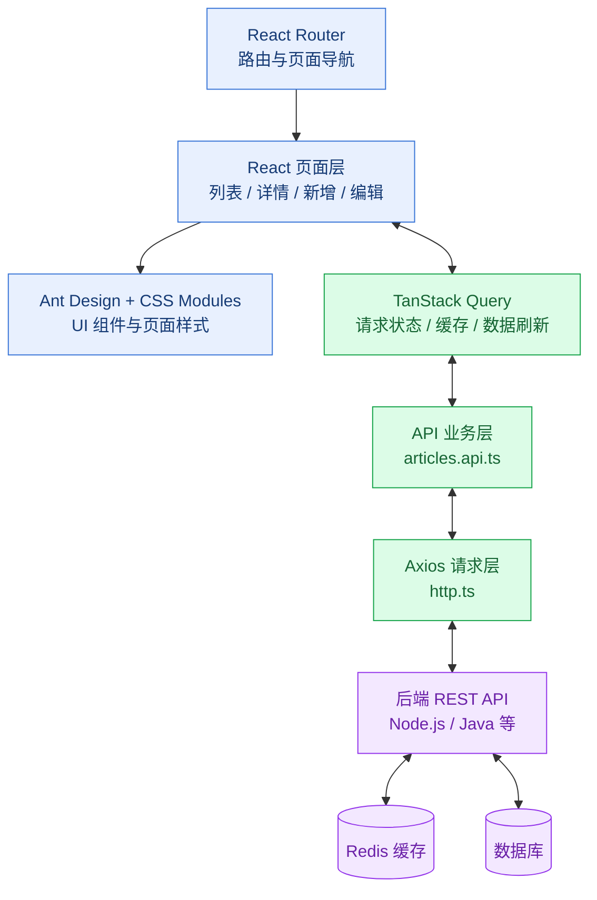

## React（Vite）


### 技术栈与职责

| 技术                       | 定位               | 用途                                                         | 是否必需 | 原因                                                         |
| -------------------------- | ------------------ | ------------------------------------------------------------ | -------- | ------------------------------------------------------------ |
| React                      | 前端 UI 框架       | 组件开发、页面渲染、状态管理、用户交互                       | ✅ 必需   | 作为项目核心框架，采用组件化开发模式，便于业务复用与维护     |
| TypeScript                 | 静态类型系统       | 组件 Props、API 数据类型、表单类型、类型检查                 | ✅ 推荐   | 提供静态类型检查，减少开发错误，提高代码可读性和可维护性     |
| React Router               | 客户端路由         | 路由、嵌套路由、URL 查询参数、页面跳转                       | ✅ 推荐   | 支持分页筛选条件保留、浏览器前进后退，满足当前需求           |
| Ant Design                 | UI 组件库          | Table、Pagination、Form、Input、Select、Modal、Layout、复杂表单、表单字段校验 | ✅ 推荐   | 业务组件完整，适合管理后台，减少组件组装工作                 |
| CSS Modules                | 局部样式方案       | 自定义页面布局、间距和特殊样式                               | ✅ 推荐   | 与 Ant Design 配合简单，避免自定义样式全局冲突               |
| Axios                      | HTTP 客户端        | GET、POST、PATCH、DELETE                                     | ✅ 选用   | 统一封装 API 请求、请求头和拦截器；简单场景可使用原生 fetch  |
| TanStack Query             | 服务器状态管理     | 列表、详情、请求状态、缓存、数据刷新、增删改操作             | ✅ 推荐   | 统一管理服务端数据的请求、缓存与更新，减少手动维护加载状态和重复请求的代码 |
| Vite                       | 前端构建工具       | 开发服务器、热模块更新（HMR）、生产环境构建                  | ✅ 选用   | 配置简单、开发启动快、支持快速热更新，适合 React 前后端分离项目 |
| MSW（Mock Service Worker） | API Mock 工具      | 模拟后端接口、CRUD 操作、网络延迟及错误响应                  | ✅ 推荐   | 拦截真实 HTTP 请求，不侵入 Axios 和 TanStack Query 业务代码，方便前后端并行开发及后续接口切换 |
| Zustand                    | 客户端全局状态管理 | 全局 UI 状态、复杂跨组件数据                                 | 暂不需要 | 局部状态与 URL 参数足够满足当前需求                          |


### 规划页面和路由

| 页面     | URL                        | 主要功能                 | 页面按钮行为 |
| -------- | -------------------------- | ------------------------ | ------------ |
| 文章列表 | `/admin/articles`          | 分页、筛选、排序         | — |
| 文章详情 | `/admin/articles/:id`      | 查看文章详情             | “返回列表”：优先跳转至进入详情前记录的完整列表 URL，保留分页、筛选和排序条件；无来源记录时跳转至默认列表 `/admin/articles` |
| 文章新增 | `/admin/articles/new`      | 填写、校验、提交         | 新增成功：跳转至默认列表 `/admin/articles`，恢复第 1 页、每页 10 条、无关键词和频道筛选、按创建时间倒序，并刷新列表数据；显示“新增成功”提示，提供“查看文章”入口，点击进入刚新增文章的详情页。<br />取消：优先跳转至进入新增前记录的完整列表 URL，保留分页、筛选和排序条件；无来源记录时跳转至默认列表 `/admin/articles` |
| 文章编辑 | `/admin/articles/:id/edit` | 获取已有数据、修改、保存 | 编辑成功：优先跳转至进入编辑前记录的完整列表 URL，保留分页、筛选和排序条件；无来源记录时跳转至默认列表 `/admin/articles`；两种情况均刷新列表数据。<br />取消：优先跳转至进入编辑前记录的完整列表 URL，保留分页、筛选和排序条件；无来源记录时跳转至默认列表 `/admin/articles` |
| 文章删除 | 无独立路由                 | 删除文章                 | 删除成功：停留在当前列表，保留分页、筛选和排序条件，并刷新数据；若当前页已无数据且存在前一页，则回退一页 |


目录

```
src/
├── layouts/
│   └── AdminLayout.tsx             -- 后台公共布局：侧边栏、顶部导航，使用 Outlet 渲染后台页面
│
├── pages/                          -- 页面级组件：负责数据获取、业务操作和页面跳转
│   └── articles/
│       ├── ArticleListPage.tsx     -- 文章列表：分页、筛选、排序、删除
│       ├── ArticleDetailPage.tsx   -- 文章详情：查询并展示文章信息
│       ├── ArticleCreatePage.tsx   -- 文章新增：使用 ArticleForm，负责新增 API 和页面跳转
│       └── ArticleEditPage.tsx     -- 文章编辑：查询已有数据，使用 ArticleForm，负责修改 API 和页面跳转
│
├── components/						-- 通用组件
│   └── articles/                   -- 文章业务组件
│       └── ArticleForm.tsx         -- 新增/编辑 共用表单
│
├── hooks/                          -- 自定义 Hooks
│   └── articles/
│       ├── articleKeys.ts           -- 统一文章 Query Key 工厂，供查询、缓存失效和移除共用
│       ├── useArticleQueries.ts    -- 使用 useQuery 查询文章列表和详情，管理缓存、加载和错误状态
│       └── useArticleMutations.ts  -- 使用 useMutation 执行新增、编辑、删除，并处理相关缓存失效
│
├── constants/                      -- 固定业务枚举
│   └── channels.ts                 -- 频道 ID、名称及下拉选项，列表筛选和文章表单共用
│
├── types/                          -- 接口与业务数据类型
│   └── articles.ts                 -- 文章、列表响应、增改请求及错误响应类型
│
├── api/                            -- API 业务层
│   └── articles.api.ts             -- 文章 API 业务层
│
├── lib/                            -- 通用基础设施
│   ├── http.ts                     -- Axios 实例
│   └── queryClient.ts              -- TanStack Query 配置
│
├── mocks/                          -- 模拟后端 API
│   ├── handlers.ts                 -- 统一注册 Mock 请求处理器
│   ├── articles.handlers.ts        -- 文章 CRUD 接口模拟
│   └── data/
│       └── articles.ts             -- 模拟文章数据
│
├── router/
│   └── index.tsx                   -- 统一路由配置：定义页面路径、嵌套路由和布局关系
│
├── App.tsx                         -- 应用根组件：提供根级布局或公共配置，使用 Outlet 渲染子路由
└── main.tsx                        -- 应用入口：挂载 React，注册 RouterProvider、全局 Provider
```


### 整体架构




### 统一缓存策略

文章列表和详情查询统一采用以下 TanStack Query 缓存配置：

| 配置 | 建议值 | 含义 |
| ---- | ------ | ---- |
| `staleTime` | `60 * 1000`（1 分钟） | 成功获取数据后，1 分钟内视为新鲜；未被主动标记失效时，正常返回页面直接复用，不因重新挂载而请求 |
| `gcTime` | `5 * 60 * 1000`（5 分钟） | 查询没有任何组件使用后，保留缓存 5 分钟，再清理；不是从获取数据时开始计时 |

返回列表或重新进入详情时：

-   有新鲜缓存：直接展示缓存，正常重新挂载时不重新请求。
-   有旧缓存：先展示缓存，同时在后台请求最新数据，不必将已有内容清空为首次加载状态。
-   无缓存：重新请求数据，显示首次加载状态。

编辑页初始化采用单独规则：新鲜详情缓存可直接初始化表单；旧缓存必须等待本次详情刷新成功后才允许编辑，无缓存则等待首次请求成功。表单初始化后，后续后台刷新不自动覆盖编辑草稿，详见「编辑文章」一节。

注意：

-   数据超过 `staleTime` 只表示变旧，不代表缓存被删除，也不会到点自动发起请求。本方案保留默认的旧数据刷新行为：重新挂载、窗口重新获得焦点或网络恢复时，可以触发后台刷新；不配置定时轮询。
-   新增、编辑、删除成功后，主动处理相关缓存，不等待 1 分钟新鲜时间结束：
    -   新增成功：使所有文章列表查询的缓存失效，覆盖不同分页、筛选和排序组合。
    -   编辑成功：使所有文章列表查询及对应文章详情的缓存失效。
    -   删除成功：使所有文章列表查询的缓存失效，并移除已删除文章的详情缓存。
-   使用 `invalidateQueries` 主动标记失效时，即使缓存仍处于 1 分钟新鲜期，也会变为旧数据；默认立即刷新正在使用的相关查询，未使用的相关查询通常在下次使用时重新获取。


### Query Key 约定

在 `hooks/articles/articleKeys.ts` 中统一定义文章 Query Key 工厂，查询、缓存失效和缓存移除均复用该工厂，不在各页面分别拼接。

| 用途 | 工厂约定 | Query Key |
| ---- | -------- | --------- |
| 所有文章查询 | `articleKeys.all` | `['articles']` |
| 所有文章列表 | `articleKeys.lists()` | `['articles', 'list']` |
| 指定条件的文章列表 | `articleKeys.list(params)` | `['articles', 'list', params]` |
| 所有文章详情 | `articleKeys.details()` | `['articles', 'detail']` |
| 指定文章详情 | `articleKeys.detail(id)` | `['articles', 'detail', id]` |

-   列表 `params` 必须先完成 URL 参数解析、校验和默认值补齐；UI、API 请求及 Query Key 使用同一份规范化参数。
-   规范化参数统一包含 `page`、`pageSize`、`keyword`、`channelId`、`sortBy`、`sortOrder`；页码和每页数量使用数字，空关键词使用空字符串，无频道筛选使用 `null`。语义相同的 URL 应生成相同的列表 Query Key。
-   文章 ID 统一使用正整数数字；从路由参数获取后先校验和转换，避免同一篇文章因字符串 ID 与数字 ID 形成不同缓存。非法 ID 显示无效地址提示，不发起详情或编辑请求。
-   新增、编辑、删除成功后，使用 `articleKeys.lists()` 前缀使所有列表查询失效；编辑时额外精确匹配 `articleKeys.detail(id)` 使对应详情失效；删除时精确匹配该详情 Key 并移除缓存，避免误处理其他文章。


### 频道枚举

-   当前频道选项使用前端固定枚举，统一维护在 `constants/channels.ts`，包含频道数字 ID、名称及可供 Select 使用的选项，不新增频道查询接口。
-   列表筛选、新增表单、编辑表单及频道名称展示共用这一份枚举，不在各页面重复写死。
-   列表中的“全部频道”表示不筛选，不是实际频道；新增和编辑表单只能选择枚举中有效的实际频道。
-   URL 参数校验和 MSW Mock 使用相同的频道 ID 约定，避免选项、筛选和模拟数据不一致。


### 设计 CRUD 功能

#### 列表查询：分页、筛选、排序

路由示例：`/admin/articles?page=2&pageSize=10&keyword=react&channelId=3&sortBy=createdAt&sortOrder=desc`


| 参数        | 含义       | 示例        | 默认值 |
| ----------- | ---------- | ----------- | ------ |
| `page`      | 当前页码   | `2`         | `1`（第 1 页） |
| `pageSize`  | 每页数量   | `10`        | `10` |
| `keyword`   | 标题关键词 | `react`     | 空，不限制标题关键词 |
| `channelId` | 所属频道   | `3`         | 不限制频道 |
| `sortBy`    | 排序字段   | `createdAt` | `createdAt` |
| `sortOrder` | 排序方向   | `desc`      | `desc`（倒序） |

默认列表 `/admin/articles` 使用以上默认值，即第 1 页、每页 10 条、无关键词和频道筛选、按创建时间倒序。“重置条件”表示恢复这些默认值，而不是取消排序。前端解析 URL 查询参数、后端接口及 MSW Mock 处理缺省参数时，应保持默认规则一致。


思路：

-   状态管理：使用 Ant Design 的 `Form` 管理尚未提交的筛选输入；URL 中的规范化参数是已生效查询条件的唯一来源
-   使用 React Router 的 `useSearchParams` 读取和更新分页、筛选和排序条件
-   首次进入列表，以及浏览器前进、后退或其他导航导致 URL 查询参数变化时，根据规范化后的 URL 筛选条件同步表单，包括清除 URL 中已不存在的关键词或频道值；不能只依赖 `initialValues` 更新已挂载表单
-   用户仅修改表单输入时，不更新 URL、不请求列表；点击“查询”后，将规范化筛选条件写入 URL，并将页码重置为 `1`
-   切换分页或排序时，基于 URL 中已生效的查询条件更新对应参数，保留其他条件，不将尚未提交的表单输入混入请求
-   使用 TanStack Query 的 `useQuery` 获取列表数据，自动管理加载状态、错误状态和客户端缓存
-   使用规范化参数生成 `articleKeys.list(params)`，参数变化时切换至对应查询，并按统一缓存策略复用缓存或请求数据；返回列表时，新鲜缓存直接复用，旧缓存先展示并后台刷新，无缓存则重新加载

##### URL 参数校验与规范化

读取 URL 后，先统一解析、校验并补齐默认值，再驱动分页、筛选表单同步、排序、API 请求和 Query Key；不将原始 URL 字符串直接用作业务参数。

| 参数 | 规范化规则 |
| ---- | ---------- |
| `page` | 转换为正的安全整数；缺省、非数字、小数、零或负数时使用 `1` |
| `pageSize` | 转换为正的安全整数；缺省或非法时使用 `10` |
| `keyword` | 去除首尾空白；缺省、空字符串或纯空白时统一使用空字符串 |
| `channelId` | 转换为频道枚举中有效的数字 ID；缺省、为空或不在枚举中时统一使用 `null`，表示不限制频道 |
| `sortBy` | 仅允许可排序字段白名单中的值，当前默认支持 `createdAt`；缺省或非法时使用 `createdAt`，后续新增可排序字段时统一扩展白名单 |
| `sortOrder` | 仅允许 `asc`、`desc`；缺省或非法时使用 `desc` |

-   仅提取约定的查询字段，其他 URL 参数不参与列表请求或 Query Key。
-   `/admin/articles` 与显式填写全部默认条件的 URL 应得到相同的规范化参数和列表 Query Key，不产生重复缓存。
-   查询时空关键词和不限制频道可从 URL 及请求参数中省略，但规范化对象中仍分别统一为 `''` 和 `null`。
-   前端规范化不能代替后端接口校验；MSW Mock 同样按约定处理参数。


#### 详情查询

路由：`/admin/articles/:id`


思路：

-   点击“详情”后，跳转至文章详情页面，保留原列表 URL 作为返回地址
-   使用 React Router 的 `useParams` 获取文章 ID
-   使用 TanStack Query 的 `useQuery` 根据文章 ID 请求详情数据，自动管理加载状态、错误状态和客户端缓存；详情查询同样采用 1 分钟新鲜时间、无人使用后保留 5 分钟的统一缓存策略


#### 新增文章

路由：`/admin/articles/new`

HTTP 方法：`POST`

思路：

-   与编辑页共用 `ArticleForm` 组件，字段包括标题、所属频道、正文；频道选项复用 `constants/channels.ts` 中的固定枚举
-   无需查询文章详情，直接挂载表单，通过 `initialValues` 提供空白默认值
-   使用 Ant Design 的 `Form` 管理表单输入和字段校验
-   使用 TanStack Query 的 `useMutation` 提交新增请求，管理提交状态和错误状态；将 `isPending` 传给提交按钮，防止重复提交
-   新增成功后返回默认列表，并提供“查看文章”入口，不自动跳转至详情页：
    -   新增接口成功响应中返回新文章的 `id`，用于直接定位刚新增的文章
    -   通过 `invalidateQueries` 使所有文章列表查询的缓存失效，覆盖不同分页、筛选和排序组合
    -   跳转至默认列表 `/admin/articles`，恢复第 1 页、每页 10 条、无关键词和频道筛选、按创建时间倒序，并获取最新列表数据
    -   在列表页显示“新增成功”提示，并提供“查看文章”入口；点击后使用新增接口返回的 `id` 跳转至 `/admin/articles/:id`
    -   不依赖新文章一定出现在列表第一条来确认新增结果，也不手动将新文章插入列表第一行；列表内容及顺序以接口查询结果为准
-   新增后的缓存失效不受 1 分钟新鲜时间限制；`invalidateQueries` 默认立即刷新正在使用的相关查询，未使用的相关查询通常在下次使用时重新获取最新数据
-   新增失败：显示错误提示，保留已填写内容，允许用户修改或重试
-   新增接口已经成功、但后续列表刷新失败时：保留“新增成功”的反馈及“查看文章”入口，单独提示列表加载失败并提供列表重试入口；不能提示为新增失败，也不能引导用户重复提交新增请求


#### 编辑文章

路由：`/admin/articles/:id/edit`

HTTP 方法：`PATCH`

思路：

-   与新增页共用 `ArticleForm` 组件，字段包括标题、所属频道、正文；频道选项复用 `constants/channels.ts` 中的固定枚举
-   使用 React Router 的 `useParams` 获取文章 ID，通过 TanStack Query 的 `useQuery` 查询对应文章详情
-   先准备好用于初始化的文章详情，再挂载表单，通过 `initialValues` 完成首次填充
-   进入编辑页时，根据详情缓存状态决定初始化时机：
    -   有新鲜缓存：直接使用缓存初始化并允许编辑
    -   有旧缓存（包括被主动标记失效的缓存）：等待本次详情刷新成功，再使用最新数据初始化并允许编辑；等待期间显示加载状态，不允许基于旧缓存编辑
    -   无缓存：等待详情请求成功，再初始化并允许编辑
    -   初始化所需的请求失败：显示错误和重试入口，不挂载可编辑表单，也不退回旧缓存开放编辑
-   表单初始化后，编辑草稿由 Ant Design 的 `Form` 独立管理输入和字段校验；同一篇文章的本次编辑过程中，后续后台刷新只更新查询缓存，不自动覆盖表单中的内容
-   不监听查询数据变化反复调用 `setFieldsValue` 或 `resetFields`；表单挂载后，即使缓存再次变旧或 `isFetching` 变为 `true`，也不重新进入初始化流程、不卸载表单，避免丢失用户输入
-   使用 TanStack Query 的 `useMutation` 提交编辑请求，管理提交状态和错误状态；将 `isPending` 传给提交按钮，防止重复提交
-   编辑接口成功：显示“保存成功”提示，通过 `invalidateQueries` 使所有文章列表查询及对应文章详情的缓存失效，并按页面按钮行为返回列表；无论返回原列表还是默认列表，均获取最新列表数据
-   编辑后的缓存失效不受 1 分钟新鲜时间限制；`invalidateQueries` 默认立即刷新正在使用的相关查询，未使用的相关查询通常在下次使用时重新获取最新数据
-   编辑接口失败：显示保存失败或字段校验提示，保留当前编辑草稿，允许用户修改或重试
-   编辑接口已经成功、但后续列表或详情刷新失败时：仍视为保存成功，按既定规则返回列表；单独提示相应数据刷新失败并提供查询重试入口，不能提示为保存失败，也不能引导用户重复提交编辑请求


#### 删除文章

思路：

-   使用 Ant Design 的 `Modal` 显示删除确认弹窗
-   使用 `useState` 管理 `deleteId`，同时判断弹窗是否打开，以及要删除哪篇文章
    -   点击删除：`setDeleteId(id)`，记录文章 ID 并打开弹窗
    -   取消删除：`setDeleteId(null)`，关闭弹窗，不执行删除操作
    -   确认删除：使用 TanStack Query 的 `useMutation` 调用删除 API
    -   删除接口成功：显示“删除成功”提示，关闭弹窗并清空 `deleteId`；通过 `invalidateQueries` 使所有文章列表查询的缓存失效（覆盖不同分页、筛选和排序组合），同时移除已删除文章的详情缓存
    -   列表缓存失效不受 1 分钟新鲜时间限制；`invalidateQueries` 默认立即刷新正在使用的列表查询，未使用的列表查询通常在下次使用时重新获取最新数据
    -   删除接口失败：显示删除失败提示，保留弹窗，允许用户重试
    -   删除接口已经成功、但后续列表刷新失败：保持弹窗关闭及 `deleteId` 已清空的状态，保留“删除成功”反馈；单独提示列表加载失败并提供列表重试入口，不能提示为删除失败，也不能重新打开弹窗引导用户重复删除
    -   删除请求进行中：使用 `useMutation` 提供的 `isPending` 禁用确认按钮，防止重复提交
-   删除成功后，保留当前分页、筛选和排序条件；若当前页已无数据且存在前一页，则回退一页


```tsx
const [deleteId, setDeleteId] = useState<number | null>(null);
```


### 后端 API

| 功能     | HTTP 方法   | API                        |
| -------- | ----------- | -------------------------- |
| 文章列表 | GET         | `/api/admin/articles`      |
| 文章详情 | GET         | `/api/admin/articles/{id}` |
| 新增文章 | POST        | `/api/admin/articles`      |
| 修改文章 | PATCH | `/api/admin/articles/{id}` |
| 删除文章 | DELETE      | `/api/admin/articles/{id}` |


思路：

-   使用 `articles.api.ts` 统一封装文章相关接口，通过 Axios 发送 HTTP 请求
-   使用 TanStack Query 的 `useQuery` 获取列表和详情数据，`useMutation` 执行新增、编辑和删除操作
-   新增接口 `POST /api/admin/articles` 的成功响应中必须包含新文章的 `id`，用于“查看文章”入口；MSW Mock 保持相同响应约定


#### 数据结构约定

在 `types/articles.ts` 中统一维护接口与业务数据类型，API 层、页面、表单及 MSW Mock 共用以下约定。当前采用下述初始字段和校验规则；后续调整时，前后端及 Mock 必须同步修改。

文章详情 `Article`：

| 字段 | 类型 | 说明 |
| ---- | ---- | ---- |
| `id` | `number` | 服务端生成的正安全整数，只读；路由、接口和 Query Key 使用相同数字类型 |
| `title` | `string` | 文章标题，保存时去除首尾空白 |
| `channelId` | `number` | 所属频道的有效数字 ID，与固定频道枚举一致 |
| `content` | `string` | 文章正文 |
| `createdAt` | `string` | 服务端生成的 ISO 8601 UTC 时间字符串；前端按展示需要格式化，编辑不修改创建时间 |

列表项 `ArticleListItem` 包含 `id`、`title`、`channelId`、`createdAt`，不包含正文；频道名称由前端枚举根据 `channelId` 映射。列表响应 `ArticleListResponse` 为 `{ items: ArticleListItem[], total: number }`，其中 `total` 是应用筛选条件后、分页前的总条数，必须为非负整数。


#### 请求字段与表单校验

新增请求 `CreateArticleInput` 包含以下全部字段；编辑请求 `UpdateArticleInput` 仅允许这些可编辑字段，不允许修改 `id` 或 `createdAt`。

| 字段 | 新增是否必填 | 校验与处理规则 |
| ---- | ------------ | -------------- |
| `title` | 是 | 必须为字符串；去除首尾空白后长度为 1–100 字符，不能只有空白 |
| `channelId` | 是 | 必须为固定频道枚举中有效的数字 ID，不能使用“全部频道”、空值或不存在的频道 |
| `content` | 是 | 必须为字符串；长度为 1–20,000 字符，不能只有空白；保留正文原有换行和有意义的空白 |

-   编辑使用 `PATCH`，至少提供一个可编辑字段；未提供的字段保持不变，已提供的字段必须通过与新增相同的校验，不允许用 `null` 清空必填字段。编辑表单也可以提交全部三个可编辑字段，不强制只提交发生变化的字段。
-   Ant Design Form 在提交前校验，服务端仍执行相同的业务校验；MSW Mock 模拟同样的规则，不能只依赖 TypeScript 或前端校验。
-   字段长度限制属于当前初始业务规则，不能由不同页面分别设置不同限制。


#### 各接口请求与成功响应

成功响应直接返回业务数据，不额外包裹 `data`、`code` 等外层字段；API 层从 Axios 响应中提取 `response.data`，供 Query hooks 使用。

| 功能 | 请求约定 | 成功状态码 | 成功响应体 |
| ---- | -------- | ---------- | ---------- |
| 列表查询 | Query 参数沿用上文分页、筛选、排序及规范化规则 | `200` | `ArticleListResponse`，即 `{ items, total }` |
| 详情查询 | 路径参数 `id` 为有效文章 ID | `200` | 完整的 `Article` |
| 新增文章 | JSON 请求体为 `CreateArticleInput` | `201` | 创建后的完整 `Article`，包含服务端生成的 `id` 和 `createdAt` |
| 编辑文章 | 路径参数 `id`；JSON 请求体为 `UpdateArticleInput` | `200` | 更新后的完整 `Article` |
| 删除文章 | 路径参数 `id`，无请求体 | `204` | 无响应体；API 层按 `void` 处理，不读取文章数据或解析 JSON |

-   列表接口先筛选、再排序、最后分页；`keyword` 用于标题包含匹配，`channelId` 用于频道精确匹配。
-   创建时间相同时，按文章 `id` 与主排序相同的方向进行次级排序，保证同一数据集上的顺序稳定；默认即 `createdAt` 倒序、`id` 倒序。
-   无匹配记录时返回 `{ items: [], total: 0 }`；页码超过当前可用页数时返回空 `items` 和真实的 `total`，前端不能将其误判为请求失败。


#### 错误响应与展示

有 HTTP 错误响应时，使用统一结构 `ApiErrorResponse`：

| 字段 | 类型 | 说明 |
| ---- | ---- | ---- |
| `code` | `string` | 稳定的业务错误码，供前端区分错误类型 |
| `message` | `string` | 可展示给用户的错误说明，不包含内部堆栈或数据库错误详情 |
| `fieldErrors` | 可选，字段名到 `string[]` 的映射 | 字段校验错误；字段名与 `title`、`channelId`、`content` 对齐，便于映射到表单 |

字段校验失败示例：

```json
{
  "code": "VALIDATION_ERROR",
  "message": "请检查表单内容",
  "fieldErrors": {
    "title": ["标题不能为空"],
    "channelId": ["请选择有效频道"]
  }
}
```

| HTTP 状态码 | 错误码 | 处理约定 |
| ----------- | ------ | -------- |
| `400` | `BAD_REQUEST` | 请求格式错误，例如无法解析的 JSON；显示请求错误提示 |
| `404` | `ARTICLE_NOT_FOUND` | 文章不存在；详情或编辑页显示不存在提示及返回列表入口，不将其作为可编辑数据 |
| `422` | `VALIDATION_ERROR` | 请求体字段不合法，例如必填字段缺失、长度超限、频道无效或空的 PATCH；表单按 `fieldErrors` 展示字段错误，其余说明展示为整体错误提示 |
| `500` | `INTERNAL_ERROR` | 服务端异常；显示通用错误提示，避免暴露内部信息 |

-   表单请求失败时保留当前输入，不因错误响应重置表单；无对应字段的错误使用整体提示。
-   网络断开、超时等情况可能没有 HTTP 响应体；前端使用本地兜底提示，不能假设所有错误都包含 `message` 或 `fieldErrors`。
-   写入接口已经明确成功后，后续查询失败仍按前文约定独立处理，不改变新增、编辑或删除的成功结果。
-   MSW Mock 的成功状态码、响应字段、字段校验和错误结构均与以上契约保持一致。


